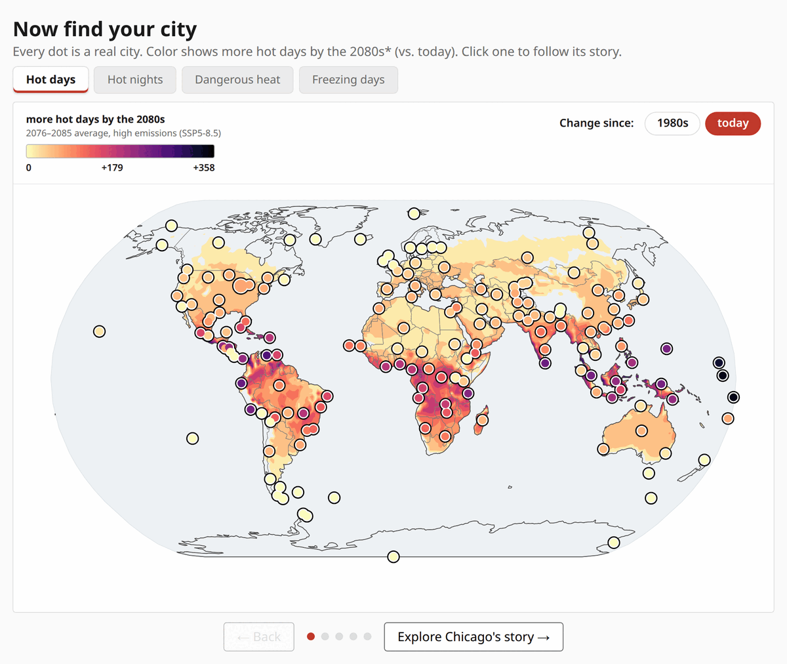
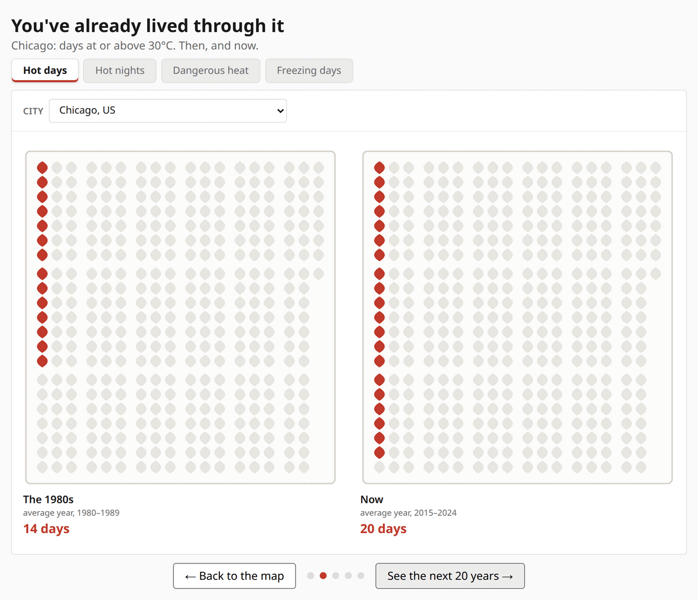

# You've Already Lived Through It

**How many extreme temperature days has your city already gained — and how many
more are coming?** An interactive data story covering 166 cities, built with D3.

### [→ Open the visualization](https://jgreen01.github.io/climate-you-lived-through-it/)



Climate change is usually told in degrees of global average warming, which is
precise and almost impossible to feel. This tells it in a unit everyone already
owns: **days in a year**.

Pick a city and follow its story. Miami went from 38 hot days a year in the
1980s to 91 today — measured, not projected. Chicago is committed to roughly
doubling its hot days again by 2045 whatever happens next. And by the 2080s,
Chicago's two possible futures stand 31 days apart, which is the part still
open to us.



Each chart is one year — 365 cells, arranged in seven-day bands so the grid is
its own ruler. The denominator never grows, so watching the coloured days
advance while the ordinary ones give way is the argument, not just the data.

Four metrics: hot days (≥30 °C), hot nights (≥26 °C), dangerous heat (≥40 °C),
and freezing days (<0 °C).

## Where the numbers come from

The distinction that matters most here is **measured versus modelled**, and the
site keeps it visible on every scene rather than blurring the two together.

| Period | Source | Kind |
|---|---|---|
| 1980–2024 | [Open-Meteo Historical Archive](https://open-meteo.com/) — daily max/min per city | **measured** |
| 2040s and 2080s | [World Bank Climate Change Knowledge Portal](https://climateknowledgeportal.worldbank.org/) — CMIP6, 0.25°, median ensemble | **modelled** |

Two emissions pathways are carried through: SSP2-4.5 (moderate) and SSP5-8.5
(high). Projections are **delta-method bias-corrected** against the model's own
recent baseline, so what is plotted is the model's *change* applied to observed
history rather than its absolute output — which keeps the future series
continuous with the measured past instead of stepping at the join.

`prep_data.py` builds the city dataset; `bake_grid.py` precomputes the map grid.

## Built with

Vanilla D3 v7 — no framework, no build step, no runtime dependencies. About 900
lines of JavaScript and 380 of CSS.

D3, `d3-annotation` and `topojson-client` are **vendored into the repository**
rather than loaded from a CDN, so the page cannot break because someone else
changed a URL.

## Running it locally

```bash
make serve          # static server on http://localhost:8000
```

Rebuilding the data (needs Python; fetches from the two sources above):

```bash
make data
```

## Tests

Playwright, asserting real values rather than smoke:

```bash
make test-setup     # install Playwright and its browsers
make test
```

The suite checks that the page loads with no console errors, that each scene
renders the chart it should, that a waffle contains exactly 365 cells with the
right count filled, and that changing city or metric re-renders correctly.

## Design rationale

The reasoning behind the message, the scene order, the choice of a waffle over a
bar chart, and the parameter/trigger model is written up separately:

**[docs/design-rationale.md](docs/design-rationale.md)**

It leans on Cleveland and McGill's ordering of elementary perceptual tasks to
justify why the map only locates and the line chart only synthesizes, while the
middle scenes carry the argument.

## License

Code is MIT — see [LICENSE](LICENSE).

The bundled data is derived from Open-Meteo and the World Bank Climate Change
Knowledge Portal and remains subject to their terms; the vendored libraries
carry their own licenses (D3 and `topojson-client` under ISC, `d3-annotation`
under MIT).
